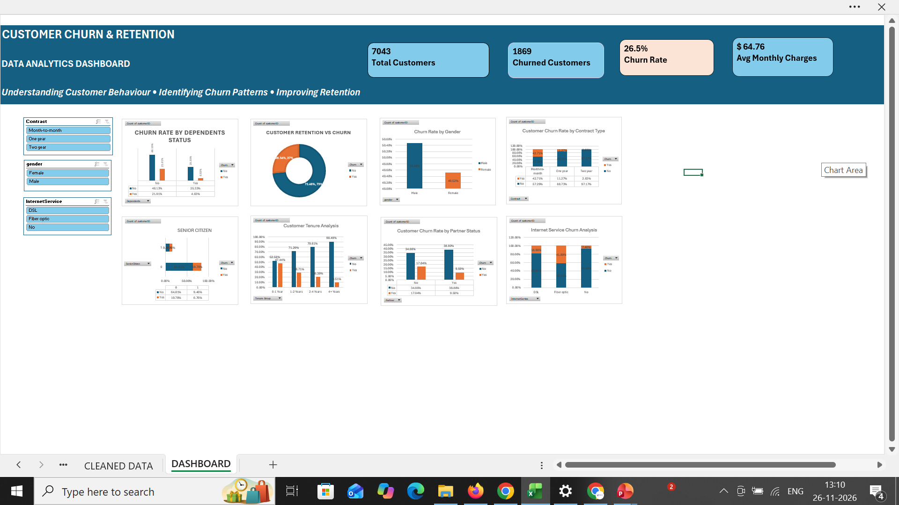

# Telco Customer Churn & Retention Analysis (Excel Dashboard)

An interactive Excel data analytics dashboard built to explore customer behaviour, identify churn patterns, and highlight retention opportunities using the Telco Customer Churn dataset.

## Dashboard Preview

## Key Metrics (KPIs)

* **Total Customers:** 7,043
* **Churned Customers:** 1,869
* **Churn Rate:** 26.5%
* **Average Monthly Charges:** $64.76

## Breakdown & Analysis Included

* **Interactive Slicers:** Filter by **Contract** (*Month-to-month*, *One year*, *Two year*), **Gender**, and **Internet Service** (*DSL*, *Fiber optic*, *No*).
* **Demographic & Account Views:**
  * Churn rate by **Dependents Status**
  * **Retained vs. Churned** customer distribution
  * **Gender** distribution and churn comparison
  * Churn patterns by **Contract Type**
  * **Senior Citizen** breakdown
  * **Customer Tenure Analysis** across tenure groups
  * Churn rate by **Partner Status**
  * **Internet Service** churn analysis

## Tools & Workflow

* **Microsoft Excel:** Data cleaning (`CLEANED DATA` sheet), Pivot Tables, Pivot Charts, Slicers, and Dashboard layout (`DASHBOARD` sheet).

## Repository Contents

* `Telco_Customer_Churn_Analysis.xlsx` — Workbook containing cleaned data and the interactive dashboard.
* `dashboard.png` — Snapshot of the final dashboard layout.
* `README.md` — Project overview and documentation.
